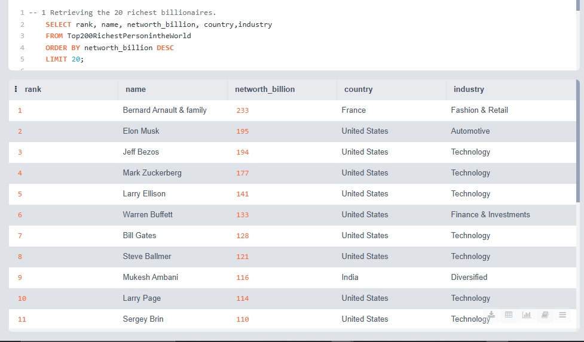

# THE BILLIONAIRE WEALTH INVESTIGATION (AN ANALYSIS USING SQL)

*NOTE: The SQL code for this project can be found above named The Billionaire Wealth Investigation.sql*
## INTRODUCTION
This project analyses wealth distribution among the world's 200 richest people, using SQL (SQLite). As a Junior Data Analyst at a global financial research organisation. The aim was to answer business questions about who holds the wealth, where they live, which industries produce them, and how age relates to net worth. I answered the questions in the project brief on wealth concentration, age generations, the richest person in each industry, and wealth gaps within industries.
## ABOUT THE DATASET
The dataset is the Top 200 Richest People in the World, taken from the Forbes list. It has 200 rows covering 35 countries and 18 industries, with no missing values. Together the billionaires hold $6,368.5 billion in net worth. This dataset captures essential information about the top 200 billionaires, offering insights into their financial standing, age, industry, and more. It is a valuable resource for analyzing trends in wealth distribution, industry dominance, and the demographics of the world's richest people.
## COLUMN DESCRIPTION
- **serial number**: Sequential numbering of the billionaires in the dataset.
-	**rank**: The global ranking of the billionaire by net worth, as per the Forbes list.
-	**name**: The name of the billionaire.
-	**age**: The age of the billionaire.
-	**country**: The name of the country the billionaire belongs to.
-	**networth_billion_US_dollars**: The total net worth of the billionaire, expressed in billions of US dollars.
-	**industry**: The industry or sector to which the billionaire's wealth is mainly attributed.

Link to Dataset: Top 200 Richest Person in the World Dataset 💰🌍💹

## SQL COMMANDS AND FUNCTIONS USED
-	**Querying and filtering**: SELECT, FROM, WHERE, AND, BETWEEN
-	**Sorting and limiting**: ORDER BY (ASC / DESC), LIMIT
-	**Grouping**: GROUP BY, HAVING
-	**Aggregate functions**: COUNT (), SUM (), AVG (), MAX (), MIN ()
- **Other functions and tools**: ROUND (), aliases (AS), CASE WHEN for age brackets and subqueries

## BUSINESS QUESTIONS AND ANALYSIS

1. Retrieve the 20 richest billionaires.
2. 
3. 
4. Identify the five youngest billionaires.
5. Calculate the average age and average net worth.
6. Identify the five most represented countries.
7. Calculate the combined net worth of billionaires from each country.
8. Identify the five industries with the highest number of billionaires.
9. Find countries with at least five billionaires.
10. Calculate the total wealth of billionaires younger than 50.
11. Identify billionaires whose net worth exceeds the overall average net worth.
10.Identify the industry with the highest average net worth.

Conclusion
Wealth in this group is heavily concentrated.
•	By country: The United States has 39.5% of the billionaires but holds 49.2% of the wealth. The top three countries (US, France, India) hold 63.5%.
•	By individual: The top 10 people hold 24.4% of the total, and only 53 of the 200 are above the average net worth of $31.84 billion. A few mega-fortunes pull the average up.
•	By industry: Technology, Finance & Investments and Fashion & Retail have the most billionaires. Telecom has the highest average net worth, but only because it has a single member, Carlos Slim. Among industries with five or more billionaires, Technology leads.
•	By age: The typical billionaire is about 69. The 60-79 bracket holds the most total wealth, while the five billionaires under 40 have the highest average ($55.7 billion).
A limit of this analysis is that the dataset is a single snapshot of the top 200, so it shows how wealth is spread at the very top, not across the whole population.

